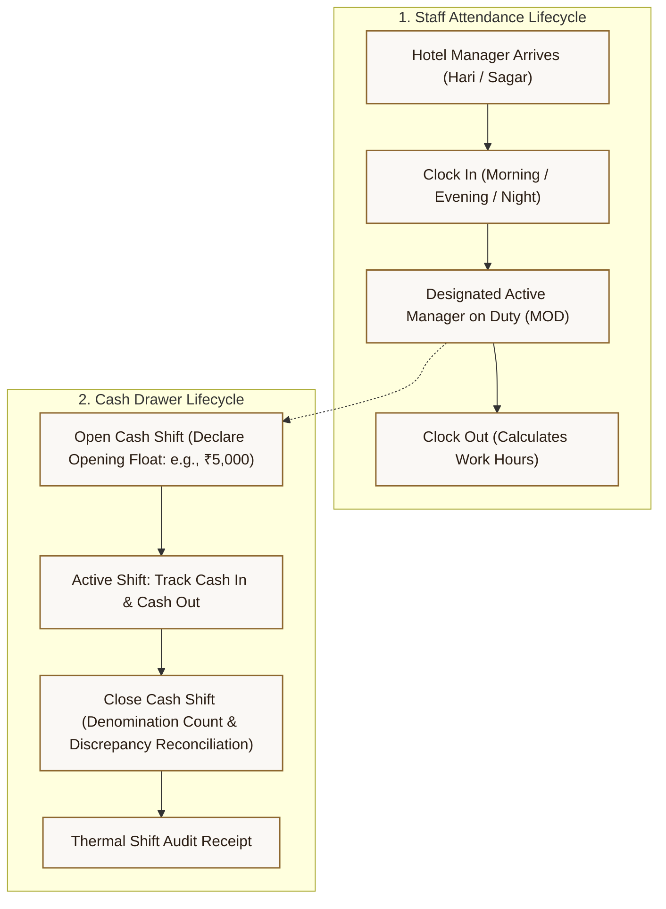
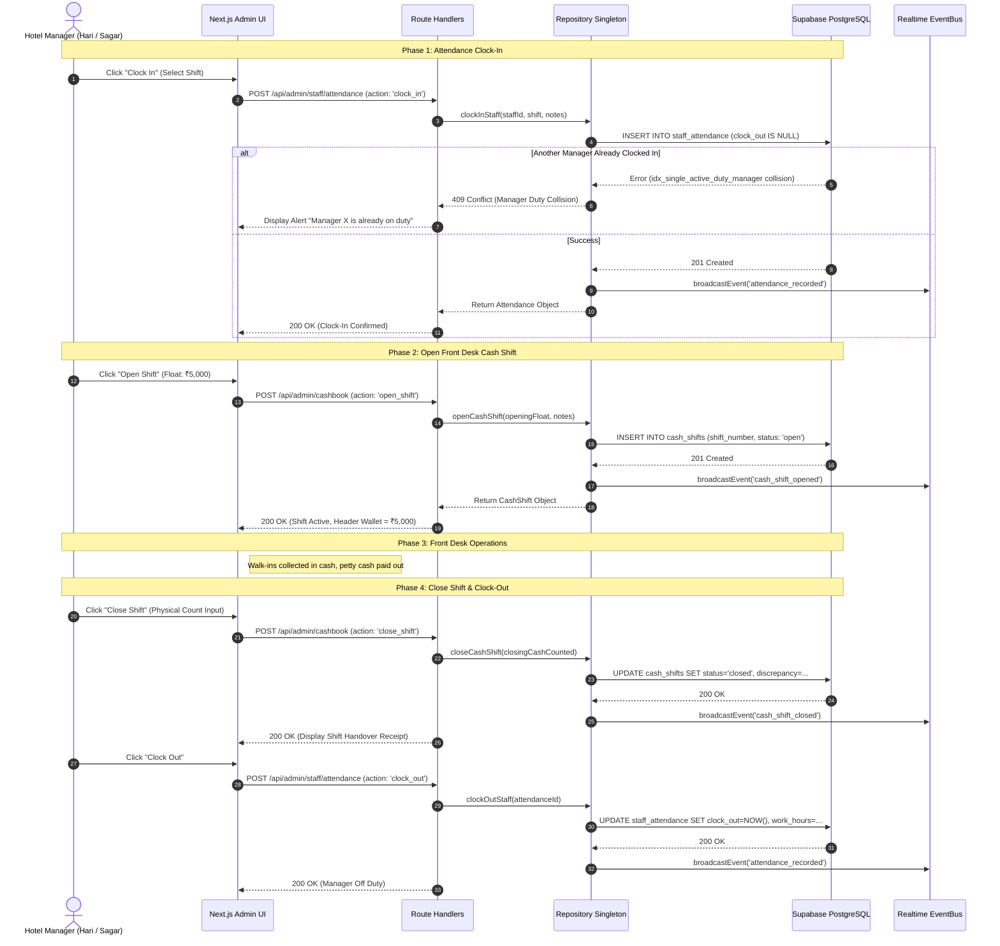

# SRI TAYI GRAND HOTEL MANAGEMENT SYSTEM
## ARCHITECTURE SPECIFICATION: MANAGER CLOCK-IN / CLOCK-OUT & CASH SHIFT LIFECYCLE
**Document Classification:** Production Architectural Handover  
**Property Identity:** Sri Tayi Grand (Kadiri, Andhra Pradesh)  
**Release Date:** 23 November 2026  

---

## 1. Architectural Overview & Domain Separation

Front-of-house operations at **Sri Tayi Grand** are governed by two distinct yet coordinated domain lifecycles:

1. **Staff Attendance Lifecycle (Manager Clock-In / Clock-Out):**
   - Regulates **human presence** and designated **Manager on Duty (MOD)** authority.
   - Enforces the **Single Active Manager on Duty Rule** across the property (exclusively assigned to Hotel Managers **Hari Achari** and **Sagar**).
   - Backed by an ACID-compliant PostgreSQL partial unique index (`idx_single_active_duty_manager`) guaranteeing zero concurrency collisions.

2. **Cash Drawer Lifecycle (Open Shift / Close Shift):**
   - Regulates **physical currency accountability** in the front desk drawer.
   - Tracks opening float, denomination breakdowns, walk-in cash intake, expense payouts, and closing physical counts.
   - Computes real-time expected balances and discrepancies with thermal handover receipt generation.



---

## 2. Manager Clock-In & Clock-Out Lifecycle

### A. Frontend Layer

- **Primary Route:** `/admin/staff/attendance` ([`src/app/admin/staff/attendance/page.tsx`](file:///c:/Users/Meesala%20Chinna%20Sai/Desktop/tayi%20grand/src/app/admin/staff/attendance/page.tsx))
- **Key State Variables:**
  - `activeDutyManager`: Evaluates `attendanceList.find(a => a.clock_in && !a.clock_out)` to detect if a manager is currently on active duty.
  - `eligibleManagers`: Filters `staffList` to allow only **Hari Achari** and **Sagar**.
  - `isClockInModalOpen`: Captures shift type (`morning`, `evening`, `night`, `general`) and optional handover notes.
- **Clock-In Event:**
  - Triggered via `handleClockInSubmit()` or `quickClockInManager()`.
  - Sends an authenticated `POST` request to `/api/admin/staff/attendance` with payload:
    ```json
    {
      "action": "clock_in",
      "staffId": "stf-01",
      "shift": "morning",
      "notes": "Morning Shift Handover"
    }
    ```
- **Clock-Out Event:**
  - Triggered via `handleClockOut(attendanceId)` when the active manager clicks **Clock Out**.
  - Sends `POST` with `{ "action": "clock_out", "attendanceId": "att-17953..." }`.
- **Reactive Wakeup:** Uses `useRealtimeSync` on SSE events `attendance_recorded`, `audit_log_created`, and `full_sync` to re-fetch attendance instantaneously without manual page refreshes.

---

### B. Backend API Layer

- **Primary Endpoint:** `/api/admin/staff/attendance` ([`src/app/api/admin/staff/attendance/route.ts`](file:///c:/Users/Meesala%20Chinna%20Sai/Desktop/tayi%20grand/src/app/api/admin/staff/attendance/route.ts))
- **Role-Based Access Control:** Validated via `verifyStaffRole(req, ['Super Admin', 'Hotel Manager', 'Front Desk', 'Receptionist', 'Accounts'])`.
- **Request Dispatching:**
  - `action === 'clock_in'`: Calls `await repo.clockInStaff(...)`.
  - `action === 'clock_out'`: Calls `await repo.clockOutStaff(...)`.
  - `GET ?date=YYYY-MM-DD`: Calls `repo.getStaffAttendance(date)` and returns shift metrics (`onDutyCount`, `morningShiftCount`, etc.).

---

### C. Business Logic Engine (Repository)

Implemented in [`src/lib/db/repository.ts`](file:///c:/Users/Meesala%20Chinna%20Sai/Desktop/tayi%20grand/src/lib/db/repository.ts):

#### 1. Clock-In Rules (`clockInStaff`):
- **Rule 1 (Duty Manager Reservation):** Only staff accounts belonging to **Hari Achari** or **Sagar** are authorized to clock in. Other roles (Super Admin, generic staff) do not participate in MOD shifts.
- **Rule 2 (Single Active Manager on Duty Rule):**
  ```typescript
  const activeDutyShift = this.staffAttendance.find((a) => Boolean(a.clock_in) && !a.clock_out);
  if (activeDutyShift) {
    if (activeIsCurrent) return activeDutyShift; // Idempotent re-entry
    throw new Error(
      `Manager Duty Collision: ${activeDutyShift.staff_name} is currently clocked in as Manager on Duty. As per hotel protocol, ${activeDutyShift.staff_name} must clock out before ${staff.full_name} can clock in.`
    );
  }
  ```
- **Audit Logging & Event Broadcasting:**
  - Triggers `this.broadcastEvent('attendance_recorded', attendance, actor)`.
  - Writes to audit log: `action: 'STAFF_CLOCK_IN'`, `details: `${staff.full_name} clocked in for ${shift} shift``.

#### 2. Clock-Out Rules (`clockOutStaff`):
- Sets `record.clock_out = new Date().toISOString()`.
- Calculates total work hours:
  $$\text{work\_hours} = \text{round}\left(\frac{\text{clock\_out} - \text{clock\_in}}{3{,}600{,}000}, 1\right)$$
- Synchronizes with database, saves to `data/staff_attendance.json`, and records audit action `STAFF_CLOCK_OUT`.

---

### D. Database Layer (Supabase PostgreSQL)

- **Table:** `public.staff_attendance`
- **Columns:**
  | Column | Data Type | Nullable | Description |
  |---|---|:---:|---|
  | `id` | `VARCHAR` | NO | Primary Key (e.g. `att-1795356841024`) |
  | `staff_id` | `VARCHAR` | NO | Staff identifier |
  | `staff_name` | `VARCHAR` | NO | Full name of duty manager |
  | `role` | `VARCHAR` | NO | Staff role (`Hotel Manager`) |
  | `date` | `DATE` | NO | Shift calendar date (`YYYY-MM-DD`) |
  | `shift` | `VARCHAR` | NO | `morning` \| `evening` \| `night` \| `general` |
  | `clock_in` | `TIMESTAMPTZ` | YES | Timestamp of clock-in |
  | `clock_out` | `TIMESTAMPTZ` | YES | Timestamp of clock-out (NULL while on duty) |
  | `status` | `VARCHAR` | NO | `present` \| `late` \| `half_day` |
  | `work_hours` | `NUMERIC` | YES | Total hours computed upon clock-out |
  | `notes` | `TEXT` | YES | Manager handover comments |
  | `created_at` | `TIMESTAMPTZ` | YES | Record creation timestamp |

- **Partial Unique Index (Concurrency Protection):**
  ```sql
  CREATE UNIQUE INDEX idx_single_active_duty_manager 
  ON public.staff_attendance USING btree ((1)) 
  WHERE (clock_out IS NULL);
  ```
  > [!IMPORTANT]
  > This index strictly enforces at the SQL engine level that **no two records can simultaneously have `clock_out IS NULL`**. Even in the event of concurrent browser submissions, the database rejects the second clock-in with a unique constraint violation.

---

## 3. Cash Drawer Open Shift & Close Shift Lifecycle

### A. Frontend Layer

- **Primary Route:** `/admin/cashbook` ([`src/app/admin/cashbook/page.tsx`](file:///c:/Users/Meesala%20Chinna%20Sai/Desktop/tayi%20grand/src/app/admin/cashbook/page.tsx))
- **Global Header / Sidebar Integration:**
  - [`AdminHeader.tsx`](file:///c:/Users/Meesala%20Chinna%20Sai/Desktop/tayi%20grand/src/components/admin/AdminHeader.tsx) and [`AdminSidebar.tsx`](file:///c:/Users/Meesala%20Chinna%20Sai/Desktop/tayi%20grand/src/components/admin/AdminSidebar.tsx) display real-time drawer cash balances through `cashbookClient`.
- **Open Shift Workflow:**
  - Modal: `isOpenShiftModalOpen`.
  - Manager enters `newOpeningFloat` (default: ₹5,000) or uses the **Denomination Counter** (₹500 × 6, ₹200 × 5, ₹100 × 8, ₹50 × 4 = ₹5,000).
  - Sends `POST /api/admin/cashbook` with `{ action: 'open_shift', openingFloat, notes, performedBy }`.
- **Active Shift Display:**
  - Shift header displays badge (e.g. `Shift #SH-20261123-01`), Cashier Name, and Opened At time.
  - Live metric cards compute:
    $$\text{Drawer Balance} = \text{Opening Float} + \text{Total Cash In} - \text{Total Cash Out}$$
- **Close Shift Workflow:**
  - Modal: `isCloseShiftModalOpen`.
  - Cashier enters actual counted cash via physical denomination inputs.
  - Automatically compares counted cash against live `expectedClosingCash`.
  - Computes discrepancy:
    $$\text{Discrepancy} = \text{Counted Cash} - \text{Expected Cash}$$
  - Sends `POST /api/admin/cashbook` with `{ action: 'close_shift', shiftId, closingCashCounted, notes }`.
  - On success, triggers `selectedShiftForPrint` modal to print the official **Front Desk Cash Shift Handover Receipt**.

---

### B. Backend API Layer

- **Primary Endpoint:** `/api/admin/cashbook` ([`src/app/api/admin/cashbook/route.ts`](file:///c:/Users/Meesala%20Chinna%20Sai/Desktop/tayi%20grand/src/app/api/admin/cashbook/route.ts))
- **Role-Based Access Control:** `verifyStaffRole(req, ['Super Admin', 'Hotel Manager', 'Front Desk', 'Accounts', 'Receptionist'])`.
- **Action Handlers:**
  1. `open_shift`:
     - Calls `repo.openCashShift({ cashierId, cashierName, openingFloat, notes })`.
     - Awaits database persistence via `syncCashShiftToSupabase(shift)`.
     - Returns HTTP 200 with new shift details.
  2. `close_shift`:
     - Calls `repo.closeCashShift({ shiftId, closingCashCounted, notes, closedByName })`.
     - Awaits `syncCashShiftToSupabase(shift)`.
     - Returns HTTP 200 with closing balance and discrepancy.
  3. `record_transaction`:
     - Handled for cash receipts (e.g., front desk walk-ins) or cash payouts (vendor/linen expenses).
     - Persists to `cash_transactions` table.
  4. `GET`:
     - Calls `repo.ensureCashbookLoaded()` to rehydrate from Supabase.
     - Returns `{ activeShift, balance, openingFloat, totalCashIn, totalCashOut, shifts, transactions }`.

---

### C. Business Logic Engine (Repository)

Implemented in [`src/lib/db/repository.ts`](file:///c:/Users/Meesala%20Chinna%20Sai/Desktop/tayi%20grand/src/lib/db/repository.ts):

#### 1. Open Cash Shift (`openCashShift`):
- Verifies that no other shift is currently active:
  ```typescript
  const existing = this.getActiveCashShift();
  if (existing) {
    throw new Error(`Shift #${existing.shift_number} is currently active. Please close it first.`);
  }
  ```
- Generates sequential shift number: `SH-YYYYMMDD-01`, `SH-YYYYMMDD-02`, etc.
- Persists to `data/cash_shifts.json` and Supabase.
- Broadcasts `cash_shift_opened` event across the SSE bus.

#### 2. Close Cash Shift (`closeCashShift`):
- Retrieves the active shift and calls `this.getCashBalance(shift.id)`.
- Calculates expected cash:
  $$\text{expectedClosing} = \text{opening\_float} + \sum \text{cash\_in} - \sum \text{cash\_out}$$
- Calculates discrepancy:
  $$\text{discrepancy} = \text{closingCashCounted} - \text{expectedClosing}$$
- Sets `shift.status = 'closed'` and `shift.closed_at = NOW()`.
- Broadcasts `cash_shift_closed` event across the SSE bus.

---

### D. Database Layer (Supabase PostgreSQL)

- **Table:** `public.cash_shifts`
- **Columns:**
  | Column | Data Type | Nullable | Description |
  |---|---|:---:|---|
  | `id` | `VARCHAR` | NO | Primary Key (e.g. `shift-1795347376163`) |
  | `shift_number` | `VARCHAR` | NO | Unique shift sequence (e.g. `SH-20261123-01`) |
  | `cashier_id` | `VARCHAR` | NO | Cashier staff profile UUID |
  | `cashier_name` | `VARCHAR` | NO | Cashier staff name |
  | `opened_at` | `TIMESTAMPTZ` | NO | Shift opening timestamp |
  | `closed_at` | `TIMESTAMPTZ` | YES | Shift closing timestamp (NULL when open) |
  | `opening_float` | `NUMERIC` | NO | Starting drawer cash (default: ₹5,000) |
  | `closing_cash_counted` | `NUMERIC` | YES | Counted physical cash at close |
  | `expected_closing_cash` | `NUMERIC` | YES | System calculated expected cash |
  | `discrepancy` | `NUMERIC` | YES | Counted minus Expected difference |
  | `status` | `VARCHAR` | NO | `open` \| `closed` |
  | `notes` | `TEXT` | YES | Opening / closing handover notes |
  | `created_at` | `TIMESTAMPTZ` | YES | Shift creation timestamp |

- **Table:** `public.cash_transactions`
  - Records individual cash movements within a shift.
  - Linked via `shift_id` to the parent `cash_shifts.id`.
  - Categories: `guest_payment`, `expense_payout`, `float_adjustment`, `other`.

---

## 4. End-to-End Sequence Flow



---

## 5. Architectural Safeguards Summary

1. **Manager On Duty Concurrency Safeguard:**
   - Physical unique index `idx_single_active_duty_manager` guarantees that two managers cannot inadvertently clock in simultaneously.
2. **Offline Durability & Persistence:**
   - Both attendance and cash shift states are persisted in dual layers: local disk files in `data/` (`staff_attendance.json`, `cash_shifts.json`) and Supabase Cloud PostgreSQL.
3. **Audit Trail Accountability:**
   - Every clock-in, clock-out, shift opening, and shift closure writes immutable audit entries with actor name, timestamp, and entity ID to `public.audit_logs`.
4. **Instant Multi-Device Sync:**
   - Real-time Server-Sent Events (SSE) automatically sync the front desk terminal, manager tablet, and dashboard without requiring manual page reloads.
