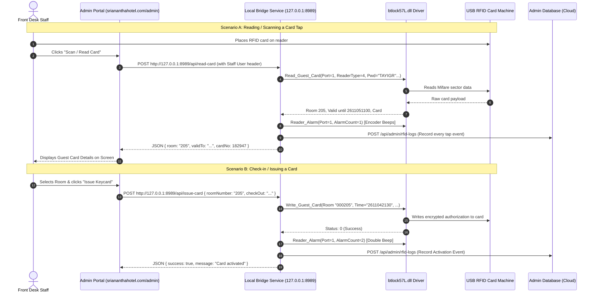

# Sri Anantha Hotel - RFID Keycard Encoder Integration Guide

This guide details the complete hardware configuration, the newly created **Local Bridge SDK Service**, and the step-by-step code required to integrate the front-desk RFID card machine with the web admin portal at **`https://sriananthahotel.com/admin`**, ensuring **every card tap is recorded in the admin log**.

---

## 1. Hardware & System Specifications Discovered

| Component | Detected Specification on Laptop |
| :--- | :--- |
| **Lock Manufacturer** | **Be-Tech Electronic Systems** |
| **Software Suite** | BIS Hotel v5.7 (Mifare 1K RFID) |
| **Core Native SDK** | `btlock57L.dll` / `btlock57.dll` (Win32 x86 StdCall) |
| **Companion Drivers** | `btmf1usb.dll`, `btmf1232.dll`, `acr120u.dll`, `AcsReader.dll` |
| **Reader Interface** | USB Port, Reader Type: `4` (USB Mifare Desktop Encoder) |
| **Hotel System Password** | `"TAYIGR"` (Stored in configuration) |
| **Card Data Format** | Room format `000XXX`, Time format `YYMMDDHHmm` (10 chars) |
| **Web Platform** | Next.js running on Vercel (`https://sriananthahotel.com`) |

---

## 2. Architecture & Data Flow



---

## 3. Working SDK: The Local Bridge Service

A dedicated lightweight 32-bit bridge service has been built and deployed on this laptop:

- **Location:** `D:\SriAnanthaRFIDBridge\`
- **Executable:** `D:\SriAnanthaRFIDBridge\SriAnanthaKeycardBridge.exe`
- **Desktop Shortcut:** An easy one-click shortcut named **`Sri Anantha RFID Bridge`** is created on your Desktop.
- **Config File:** `D:\SriAnanthaRFIDBridge\bridge_config.ini`

### Bridge Configuration (`bridge_config.ini`)
```ini
# Sri Anantha Hotel - RFID Hardware Bridge Config
port=1
readertype=4
sectorno=0
hotelpwd=TAYIGR
adminapiurl=https://sriananthahotel.com/api/admin/rfid-logs
listenport=8989
```

---

## 4. Local REST API Reference (Port 8989)

The bridge runs an HTTP server on `http://127.0.0.1:8989` with **CORS enabled** (`Access-Control-Allow-Origin: *`).

### A. Health Check
- **Endpoint:** `GET /api/status`
- **Response:**
  ```json
  {
    "status": "ok",
    "service": "SriAnantha-RFID-Bridge",
    "port": 1,
    "readerType": 4
  }
  ```

### B. Read / Tap Card
- **Endpoint:** `POST /api/read-card`
- **Headers:** `X-Staff-User: <logged_in_admin_user>`
- **Response (Success):**
  ```json
  {
    "success": true,
    "code": 0,
    "roomNumber": "205",
    "cardNo": 182947,
    "guestSN": 182947,
    "beginTime": "2611042130",
    "endTime": "2611051100",
    "message": "Card read successfully"
  }
  ```
- **Response (No card on reader):**
  ```json
  {
    "success": false,
    "code": 6,
    "error": "No RFID card placed on reader"
  }
  ```

### C. Issue / Activate Card (Guest Check-In)
- **Endpoint:** `POST /api/issue-card`
- **Headers:** `X-Staff-User: <logged_in_admin_user>`
- **Payload:**
  ```json
  {
    "roomNumber": "205",
    "beginTime": "2611042130",
    "endTime": "2611051100",
    "staffUser": "admin_rahul"
  }
  ```
- *Note:* If `beginTime` and `endTime` are omitted, the bridge automatically sets `beginTime` to current time and `endTime` to 11:00 AM the following day.

### D. Deactivate Card (Guest Check-Out)
- **Endpoint:** `POST /api/checkout-card`
- **Payload:**
  ```json
  {
    "roomNumber": "205",
    "staffUser": "admin_rahul"
  }
  ```

---

## 5. Web Admin Integration (`sriananthahotel.com/admin`)

### Step 1: Create the RFID Log API Route in Next.js
In your Next.js project on Vercel, create the file:
`app/api/admin/rfid-logs/route.ts` (App Router) or `pages/api/admin/rfid-logs.ts` (Pages Router).

```typescript
// app/api/admin/rfid-logs/route.ts
import { NextResponse } from 'next/server';
// import { prisma } from '@/lib/prisma'; // or your existing database client

export async function POST(req: Request) {
  try {
    const data = await req.json();

    const {
      event_type,   // 'TAP_READ' | 'TAP_ACTIVATE' | 'TAP_DEACTIVATE' | 'TAP_READ_FAIL'
      room_number,  // e.g. "205"
      card_no,      // e.g. 182947
      begin_time,   // e.g. "2611042130"
      end_time,     // e.g. "2611051100"
      staff_user,   // e.g. "reception_admin"
      status,       // "SUCCESS" or error description
      timestamp     // "2026-11-04 21:30:15"
    } = data;

    // 1. Log to console / log aggregator
    console.log(`[RFID TAP AUDIT] ${timestamp} | ${event_type} | Room: ${room_number} | Staff: ${staff_user}`);

    // 2. Insert into your database (e.g. Prisma / SQL / MongoDB):
    /*
    await prisma.rfidLog.create({
      data: {
        eventType: event_type,
        roomNumber: room_number,
        cardNo: String(card_no),
        beginTime: begin_time,
        endTime: end_time,
        staffUser: staff_user,
        status: status,
        createdAt: new Date(timestamp)
      }
    });
    */

    return NextResponse.json({ success: true, message: 'Tap logged' });
  } catch (error: any) {
    console.error('Error logging RFID tap:', error);
    return NextResponse.json({ success: false, error: error.message }, { status: 500 });
  }
}

// GET endpoint to display tap logs in the admin dashboard
export async function GET() {
  /*
  const logs = await prisma.rfidLog.findMany({
    orderBy: { createdAt: 'desc' },
    take: 50
  });
  return NextResponse.json(logs);
  */
  return NextResponse.json([]);
}
```

---

### Step 2: Frontend Client Helper (`lib/rfidClient.ts`)
Create a helper on the frontend to communicate with the local bridge:

```typescript
// lib/rfidClient.ts
const BRIDGE_URL = 'http://127.0.0.1:8989';

export interface RfidReadResult {
  success: boolean;
  code?: number;
  roomNumber?: string;
  cardNo?: number;
  beginTime?: string;
  endTime?: string;
  error?: string;
}

export async function readCard(staffUsername: string): Promise<RfidReadResult> {
  try {
    const res = await fetch(`${BRIDGE_URL}/api/read-card`, {
      method: 'POST',
      headers: {
        'Content-Type': 'application/json',
        'X-Staff-User': staffUsername
      }
    });
    return await res.json();
  } catch (err: any) {
    return {
      success: false,
      error: 'Cannot connect to RFID Bridge. Ensure "Sri Anantha RFID Bridge" is running on this laptop.'
    };
  }
}

export async function issueKeycard(params: {
  roomNumber: string;
  checkInDate?: Date;
  checkOutDate?: Date;
  staffUsername: string;
}) {
  try {
    const formatTime = (d: Date) => {
      const yy = String(d.getFullYear()).slice(-2);
      const mm = String(d.getMonth() + 1).padStart(2, '0');
      const dd = String(d.getDate()).padStart(2, '0');
      const hh = String(d.getHours()).padStart(2, '0');
      const mi = String(d.getMinutes()).padStart(2, '0');
      return `${yy}${mm}${dd}${hh}${mi}`;
    };

    const payload: any = {
      roomNumber: params.roomNumber,
      staffUser: params.staffUsername
    };

    if (params.checkInDate) payload.beginTime = formatTime(params.checkInDate);
    if (params.checkOutDate) payload.endTime = formatTime(params.checkOutDate);

    const res = await fetch(`${BRIDGE_URL}/api/issue-card`, {
      method: 'POST',
      headers: {
        'Content-Type': 'application/json',
        'X-Staff-User': params.staffUsername
      },
      body: JSON.stringify(payload)
    });
    return await res.json();
  } catch (err) {
    return {
      success: false,
      error: 'Failed to contact local RFID hardware bridge.'
    };
  }
}

export async function deactivateCard(roomNumber: string, staffUsername: string) {
  try {
    const res = await fetch(`${BRIDGE_URL}/api/checkout-card`, {
      method: 'POST',
      headers: {
        'Content-Type': 'application/json',
        'X-Staff-User': staffUsername
      },
      body: JSON.stringify({ roomNumber, staffUser: staffUsername })
    });
    return await res.json();
  } catch (err) {
    return {
      success: false,
      error: 'Failed to contact local RFID hardware bridge.'
    };
  }
}
```

---

### Step 3: Admin UI Component (React/Tailwind)
Add this component to your admin dashboard (`sriananthahotel.com/admin`):

```tsx
// components/admin/RfidManager.tsx
'use client';

import React, { useState } from 'react';
import { readCard, issueKeycard, deactivateCard } from '@/lib/rfidClient';

export default function RfidManager({ activeStaffUser }: { activeStaffUser: string }) {
  const [roomNumber, setRoomNumber] = useState('');
  const [loading, setLoading] = useState(false);
  const [statusMessage, setStatusMessage] = useState<{ text: string; type: 'success' | 'error' | 'info' } | null>(null);

  // 1. Scan/Read Card Tap
  const handleScanCard = async () => {
    setLoading(true);
    setStatusMessage({ text: 'Please place card on encoder...', type: 'info' });

    const result = await readCard(activeStaffUser);
    setLoading(false);

    if (result.success) {
      setRoomNumber(result.roomNumber || '');
      setStatusMessage({
        text: `Card Read: Room ${result.roomNumber} (Card #${result.cardNo}). Valid until: ${result.endTime}`,
        type: 'success'
      });
    } else {
      setStatusMessage({ text: result.error || 'Failed to read card.', type: 'error' });
    }
  };

  // 2. Issue Card (Check-in)
  const handleIssueKey = async () => {
    if (!roomNumber) {
      alert('Please enter a room number');
      return;
    }
    setLoading(true);
    setStatusMessage({ text: `Writing Room ${roomNumber} to card...`, type: 'info' });

    const result = await issueKeycard({
      roomNumber,
      staffUsername: activeStaffUser
    });
    setLoading(false);

    if (result.success) {
      setStatusMessage({ text: `Room ${roomNumber} key successfully activated!`, type: 'success' });
    } else {
      setStatusMessage({ text: result.error || 'Failed to activate keycard.', type: 'error' });
    }
  };

  // 3. Checkout / Deactivate Card
  const handleDeactivate = async () => {
    setLoading(true);
    const result = await deactivateCard(roomNumber, activeStaffUser);
    setLoading(false);

    if (result.success) {
      setStatusMessage({ text: 'Card deactivated and cleared.', type: 'success' });
    } else {
      setStatusMessage({ text: result.error || 'Failed to deactivate card.', type: 'error' });
    }
  };

  return (
    <div className="bg-white dark:bg-gray-800 p-6 rounded-xl shadow-md border border-gray-200">
      <h2 className="text-xl font-bold mb-4 flex items-center gap-2">
        <span>💳</span> RFID Door Lock Management
      </h2>

      <div className="flex flex-col gap-4 max-w-md">
        <div>
          <label className="block text-sm font-medium text-gray-700 mb-1">Room Number</label>
          <input
            type="text"
            value={roomNumber}
            onChange={(e) => setRoomNumber(e.target.value)}
            placeholder="e.g. 205"
            className="w-full px-3 py-2 border rounded-lg focus:ring-2 focus:ring-blue-500"
          />
        </div>

        <div className="grid grid-cols-3 gap-2">
          <button
            onClick={handleScanCard}
            disabled={loading}
            className="bg-blue-600 hover:bg-blue-700 text-white font-medium py-2 px-3 rounded-lg text-sm"
          >
            🔍 Read Tap
          </button>

          <button
            onClick={handleIssueKey}
            disabled={loading}
            className="bg-green-600 hover:bg-green-700 text-white font-medium py-2 px-3 rounded-lg text-sm"
          >
            🔑 Issue Key
          </button>

          <button
            onClick={handleDeactivate}
            disabled={loading}
            className="bg-red-600 hover:bg-red-700 text-white font-medium py-2 px-3 rounded-lg text-sm"
          >
            🚫 Check-Out
          </button>
        </div>

        {statusMessage && (
          <div
            className={`p-3 rounded-lg text-sm font-medium ${
              statusMessage.type === 'success'
                ? 'bg-green-50 text-green-800 border border-green-200'
                : statusMessage.type === 'error'
                ? 'bg-red-50 text-red-800 border border-red-200'
                : 'bg-blue-50 text-blue-800 border border-blue-200'
            }`}
          >
            {statusMessage.text}
          </div>
        )}
      </div>
    </div>
  );
}
```

---

## 6. How to Start & Run on the Front Desk Laptop

1. **Connect the USB RFID Encoder** to the laptop.
2. Double-click the desktop shortcut: **`Sri Anantha RFID Bridge`**.
3. A black console window will open displaying:
   ```text
   ========================================================
      SRI ANANTHA HOTEL - RFID HARDWARE BRIDGE SERVICE     
      Hardware: Be-Tech BIS 5.7 (btlock57l.dll)            
      Local Endpoint: http://127.0.0.1:8989/            
   ========================================================
   [CONFIG] Loaded configuration from bridge_config.ini
   [INFO] Bridge service is listening on port 8989
   [INFO] Ready for requests from sriananthahotel.com/admin
   ```
4. Log in to **`https://sriananthahotel.com/admin`** in your browser.
5. Place any card on the reader and click **"Read Tap"** or **"Issue Key"**:
   - The encoder will **beep**.
   - The card will be read or written.
   - The event will be recorded both in `D:\SriAnanthaRFIDBridge\rfid_tap_audit.log` and sent to the admin portal database.
